<p align="center">
  
</p>

<h1 align="center">LAZEYKA</h1>

<p align="center">
  Программа для Windows, macOS и Linux (Ubuntu), которая собирает в одном окне обход DPI (Zapret),<br/>
  VPN на ядрах sing-box и Xray, игровой режим и прокси для Telegram.
</p>

<p align="center">
  <a href="./LICENSE"></a>
  
  
  
</p>

<p align="center">
  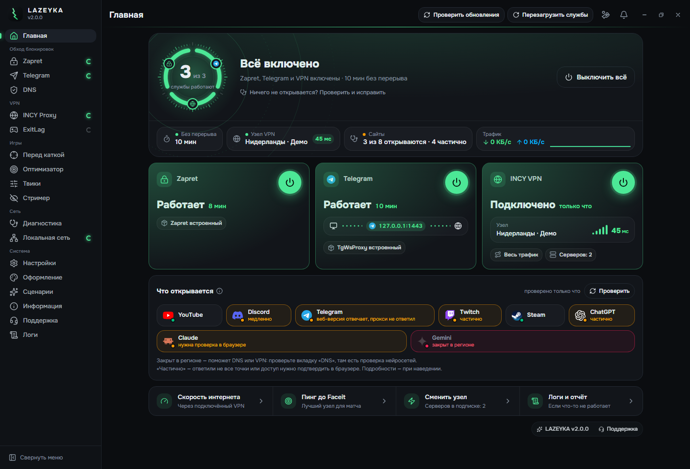
</p>

## Скачать

| Система | Файл |
| --- | --- |
| **Windows** 10 / 11 (x64) | [`LAZEYKA_x64.exe`](https://github.com/reb0oornalexey/LAZEYKA/releases/latest/download/LAZEYKA_x64.exe) — установщик, или [`LAZEYKA_x64-portable.7z`](https://github.com/reb0oornalexey/LAZEYKA/releases/latest/download/LAZEYKA_x64-portable.7z) — портативная версия |
| **macOS** 14+, Apple Silicon (серия M) | [`LAZEYKA_arm64.dmg`](https://github.com/reb0oornalexey/LAZEYKA/releases/latest/download/LAZEYKA_arm64.dmg) |
| **macOS** 14+, Intel | [`LAZEYKA_x64.dmg`](https://github.com/reb0oornalexey/LAZEYKA/releases/latest/download/LAZEYKA_x64.dmg) |
| **Linux — Ubuntu 24.04 (x64)** | [`LAZEYKA_amd64.deb`](https://github.com/reb0oornalexey/LAZEYKA/releases/download/v2.0.0/LAZEYKA_amd64.deb) — пакет для Ubuntu |

Все версии — на странице [последнего релиза](https://github.com/reb0oornalexey/LAZEYKA/releases/latest).
На Mac откройте меню Apple → «Об этом Mac», чтобы узнать тип процессора.
См. [установку на macOS](#macos) и [установку на Ubuntu](#ubuntu).

## Зачем это нужно

Сайты блокируют по-разному, и одного способа на все случаи нет. VPN меняет
IP и может изменить скорость или доступ к локальным сервисам. Zapret
сохраняет ваш IP и помогает при части видов блокировок. У Telegram свои проблемы с медиа и звонками.

LAZEYKA держит эти способы в одной программе. Начните с самого лёгкого и
добавляйте следующий, только если не хватило.

> LAZEYKA не продаёт VPN и не держит своих серверов. Для раздела INCY нужна
> ссылка на подписку от стороннего провайдера.

## Что нового в 2.0.0

Впервые доступна сборка для Ubuntu. В приложении обновились все вкладки.
В Zapret можно проверить одну стратегию, в INCY — проверить пару узлов перед
подключением, а в диагностике — увидеть, на каком этапе сайт перестал отвечать.
Телефон можно использовать как пульт. Отправка отчётов, идей и просмотр тем
доступны внутри LAZEYKA. Снимки сделаны на демонстрационном профиле.
[Все изменения 2.0.0](./CHANGELOG.md).

## Возможности

- **Zapret** — обход DPI без смены IP.
- **INCY** — VPN на ядрах sing-box и Xray: подписки, режим TUN, раздельная
  маршрутизация, цепочка из двух узлов, Kill Switch.
- **ExitLag** — через VPN идут только выбранные игры и программы.
- **Telegram-прокси** — ускоряет медиа и чинит звонки, остальной интернет не трогает.
- **Шифрованный DNS** — каталог серверов, который обновляется сам, и проверка,
  какой DNS открывает нейросети в вашей сети.
- **Игры** — оптимизатор маршрута до сервера, проверка сети «Перед каткой»,
  твики Windows против скачков пинга, режим стримера и кнопки для Stream Deck.
- **Локальная сеть** — пульт на телефоне, прокси для телевизора, приставки и
  телефона, раздача Wi-Fi с компьютера.
- **Диагностика** — проверка сайтов, утечки IP и DNS, Wi-Fi, белые списки.
- **Сценарии и горячие клавиши**, мини-окно поверх игры, звуки, статус в Discord.
- **Оформление** — темы, свой фон и галерея тем от других людей.
- **Связь с автором** — отчёт о проблеме и идеи прямо из программы, ответы
  приходят в колокольчик в шапке окна.

## С чего начать

1. Включите Zapret на вкладке «Zapret» и проверьте нужный сайт. Если не
   открылся, выберите другую стратегию из каталога или запустите
   перетестирование.
2. Если не хватило, добавьте VPN: «INCY Proxy» → «Сервера», вставьте ссылку
   на подписку или нажмите «Из буфера». Выберите сервер с зелёным пингом.
3. Если тормозит Telegram, включите его на вкладке «Telegram». Кнопка
   подключения сама передаст настройки в мессенджер.
4. Если играете, откройте «ExitLag»: через VPN пойдут только выбранные игры,
   остальной трафик останется напрямую.

Включайте способы по одному и проверяйте результат после каждого. Если
запустить всё сразу и что-то сломается, будет непонятно, что виновато.

## Главная

Общий статус («Защита работает», «Работает частично» или «Всё выключено»),
узел VPN и пинг, карточки Zapret, Telegram и INCY с переключателями и график
скорости сети. Замер скорости можно остановить в любой момент. Панель «Что сейчас работает» показывает YouTube, Discord,
Telegram, Twitch, Steam, ChatGPT, Claude и Gemini. Плитки показывают результат
проверки, а по нажатию можно открыть подробную диагностику. Для Telegram
веб-версия и прокси проверяются отдельно. Внизу быстрые переходы: скорость
интернета, оптимизатор, смена узла и логи.

Тема светлая или тёмная, боковое меню сворачивается в полоску иконок.

## Zapret: обход блокировок без VPN

<p align="center">
  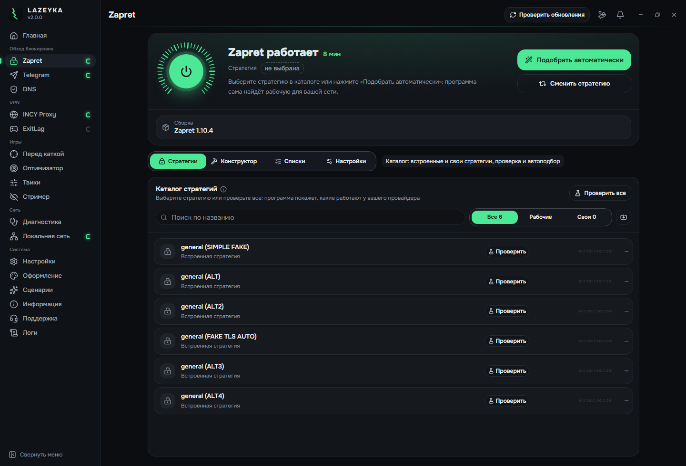
</p>

Оболочка над `winws.exe` и драйвером `WinDivert` (на macOS — над движком
`utunws` из официального Mac-порта Flowseal, стратегии те же). Трафик никуда не
перенаправляется: Zapret меняет вид запросов так, что оборудование
провайдера может пропустить запрос к сайту. IP остаётся вашим.

- В каталоге можно проверить одну стратегию или запустить общий тест. Свои
  стратегии, в том числе сохранённые после автоподбора, участвуют в проверке.
- Автопилот следит за доступностью YouTube и Discord и сам меняет стратегию,
  если у провайдера что-то поменялось.
- Игровой режим замечает запуск игры и выводит её трафик из-под обработки,
  чтобы обход не добавлял пинг.
- Список хостов и IP: готовые наборы (Discord, Telegram, YouTube, Cloudflare,
  Twitch, Spotify) и полный пак от автора на 125 тысяч строк. Добавление
  дописывает к вашему списку без дублей.
- Конструктор на Windows собирает стратегию из отдельных настроек. Если
  готовые варианты не подошли, «Подобрать автоматически» пробует варианты,
  уточняет параметры и повторно проверяет лучшие результаты на вашей сети.

## INCY: VPN на двух ядрах

<p align="center">
  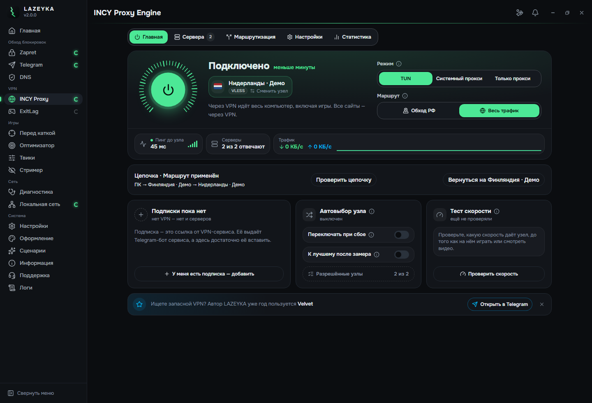
</p>

| Ядро | Что умеет |
| --- | --- |
| `sing-box` | VLESS/Reality, Hysteria2, Trojan, Shadowsocks, WireGuard (WARP), режим TUN |
| `xray` | VLESS, VMess, Trojan, Shadowsocks, фрагментация TLS ClientHello, шумовые пакеты, mux |

Ядро выбирается под узел автоматически: sing-box, Xray или связка, где
sing-box держит TUN и передаёт трафик в Xray через локальный мост.

- Три режима: TUN (весь компьютер), системный прокси (браузеры и программы,
  которые читают системные настройки прокси) и только прокси (локальный порт).
- Несколько подписок одновременно, у каждой своя карточка с трафиком, сроком
  и расписанием обновления. Конфигурация провайдера переносится как есть,
  поэтому работают и редкие транспорты (ws, grpc, httpupgrade, xhttp).
- Бесплатный узел Cloudflare WARP одной кнопкой.
- Пинг честный: способ «Умный» показывает задержку, только если через сервер
  реально идёт трафик. Сервер с открытым портом и упавшим VPN будет «нет
  ответа». Фильтр «Только рабочие» прячет такие серверы.
- Автовыбор узла: при сбое переключается на рабочий узел. Какие узлы можно
  выбирать автоматически, решаете вы.
- Kill Switch: если VPN оборвался, трафик, который шёл через VPN,
  блокируется до переподключения. Российские сайты и локальная сеть
  продолжают работать. Переподключение идёт само.
- Тест скорости через выбранный сервер измеряет задержку, скачивание и
  отдачу. Активный VPN сохраняется.
- Маршрутизация: профили «Раздельно» (российские сайты напрямую),
  «Глобально» и «Напрямую», 20 гео-категорий с отдельными переключателями и
  свои правила «домен или подсеть → напрямую, туннель или блок». Свои
  правила главнее готовых списков.
- Статистика по реальным байтам из ядра, история за 14 дней.
- Резервная копия подписок, серверов, правил и настроек в один файл. Перед
  восстановлением видно, что в нём лежит.
- Цепочка узлов: вход и выход выбираются отдельно, рядом с узлами виден
  пинг. INCY проверяет HTTPS до применения пары, при сбое проверяет оба
  узла отдельно. На главной вкладке INCY виден активный маршрут, там же
  можно вернуться на предыдущий узел.
- «Соединения»: какая программа куда подключается; любой сайт можно отправить
  через VPN или напрямую.
- Исключённые маршруты (принтер, рабочая сеть, игровой сервер) идут мимо
  туннеля в режиме TUN.

## ExitLag: VPN только для игр

<p align="center">
  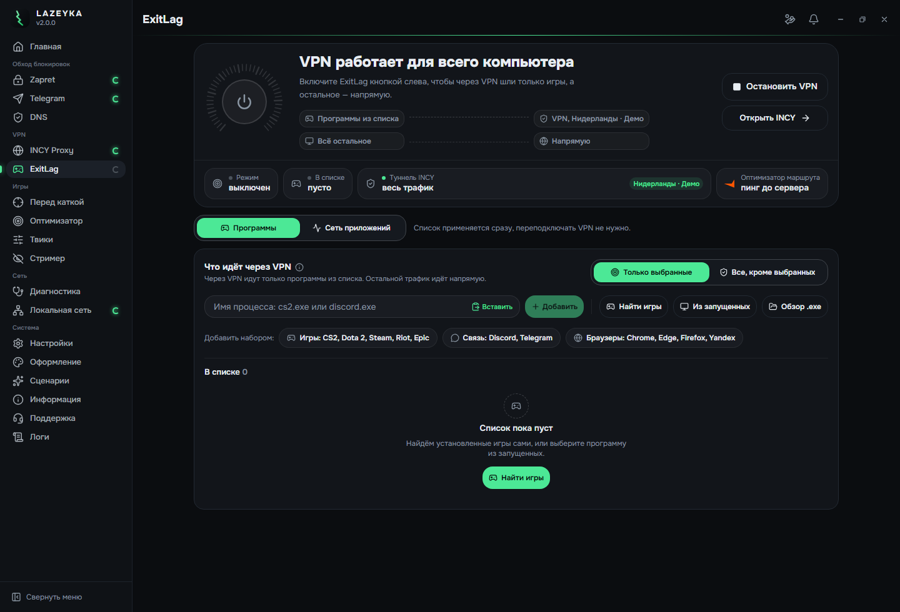
</p>

Туннелирование по приложениям в двух режимах. «Только выбранные»: через
VPN идут только указанные игры и программы, а браузеры, система и торренты
соединяются напрямую. «Все, кроме выбранных»: весь компьютер работает через
VPN, а указанные приложения идут в обход.

Есть готовые наборы (игры, Discord и Telegram, браузеры). Кнопка «Найти
игры» находит установленные игры Steam и Epic. Приложение можно также выбрать
из запущенных процессов, указать `.exe` через проводник или вписать имя
процесса вручную. Блок «Сейчас в сети» показывает, какие приложения из списка
выходят в интернет, через VPN или напрямую, и с какой скоростью.

## Оптимизатор маршрута для CS2

<p align="center">
  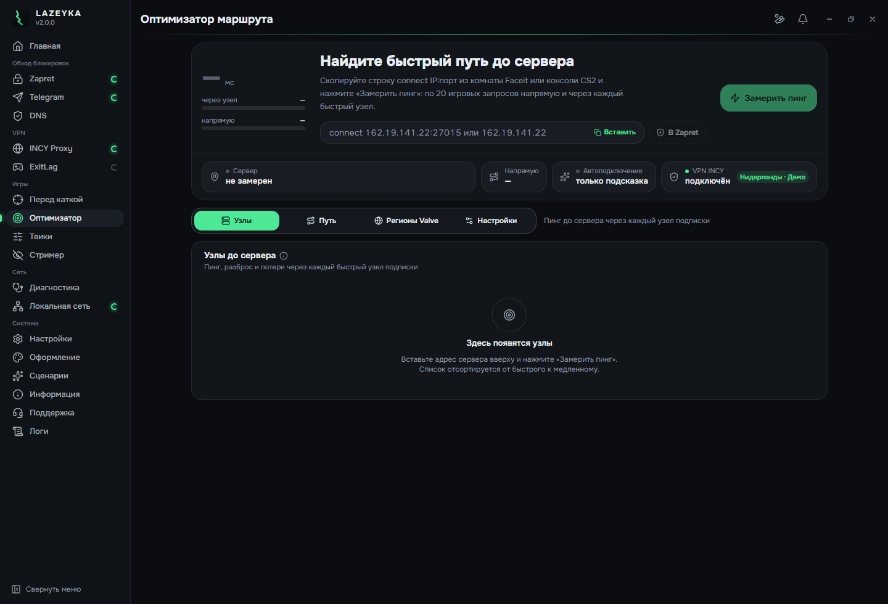
</p>

Вставьте строку `connect IP:порт` из комнаты матча или консоли CS2.
Оптимизатор отправит по 20 игровых запросов (A2S) напрямую и через каждый
быстрый узел подписки и покажет пинг, джиттер и потери, как их видит сама
игра. После замера может сам подключиться к лучшему узлу и добавить IP
сервера в список Zapret.

Для обычного матчмейкинга CS2 и Dota 2 есть таблица регионов Valve: пинг до
каждого региона напрямую и замер через каждый узел VPN до серверов Steam в
том же датацентре; в таблице лучший узел для региона. Кнопка «Добавить в
Zapret» ничего не просит ввести: она заносит в списки Zapret всю сеть Valve
(AS32590, все её подсети) и ретрансляторы партнёров Valve из списков Steam
для CS2 и Dota 2. Для работы с игровым трафиком нужны Game Filter с UDP и
включённый IPset. Под кнопкой видно, всё ли включено, а если нет, кнопка
«Открыть настройки» переводит прямо к нужным переключателям Zapret.

## Перед каткой

<p align="center">
  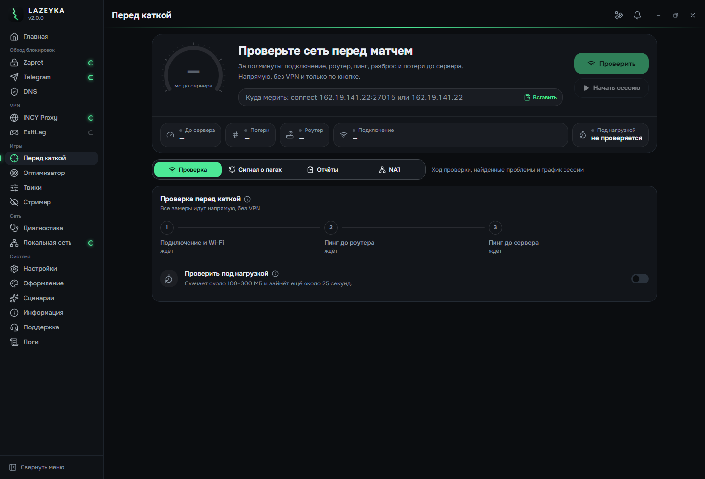
</p>

Проверка пинга, потерь и Wi-Fi до выбранного сервера перед матчем. Во время
игры можно включить предупреждения о росте пинга и потерях, после матча
посмотреть отчёт.

## Твики

<p align="center">
  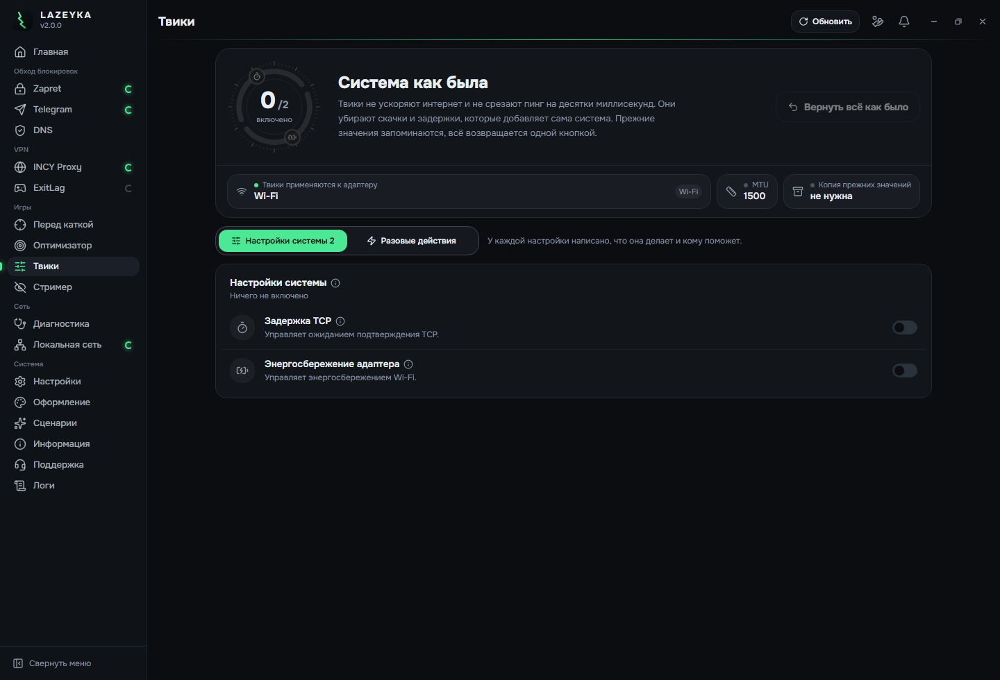
</p>

Настройки Windows для сетевых задержек. У каждой есть описание и возможность
вернуть прежнее значение.

## Стример

<p align="center">
  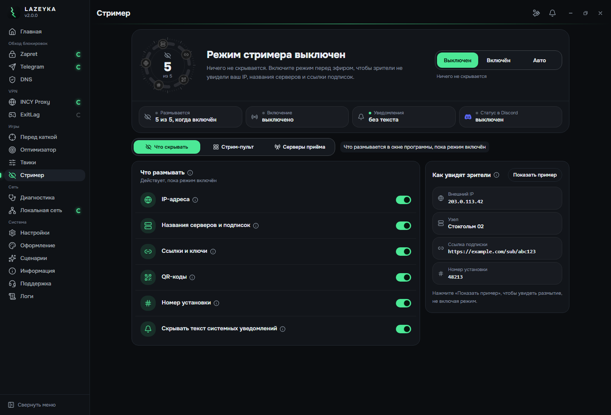
</p>

Режим стримера скрывает IP, серверы и ссылки подписок в интерфейсе. Его можно
включать вручную или автоматически при запуске OBS. Для Stream Deck есть
действия для переключения служб и запуска сценариев.

## Локальная сеть: телевизор, приставка, телефон

<p align="center">
  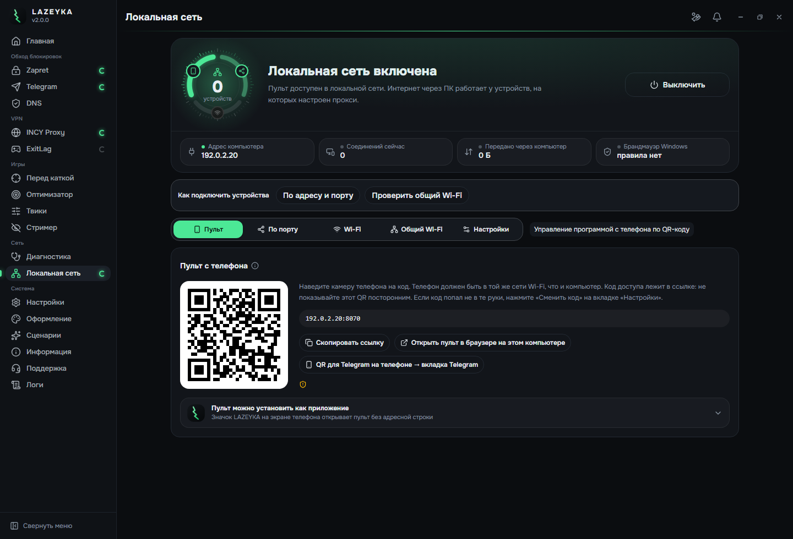
</p>

Раздел выключен по умолчанию. Устройства и компьютер должны видеть друг
друга в локальной сети. В разделе доступны четыре способа подключения и
проверки.

- **Пульт** открывается на телефоне по QR-коду. Через него можно включать
  Zapret, INCY и Telegram-прокси, менять узел и DNS, запускать сценарии.
  Кнопка «Проверить этот телефон» проверяет, идёт ли браузер через компьютер.
- **По порту** показывает адрес общего HTTP/SOCKS5-прокси, инструкции для
  устройств и проверку YouTube через прокси. Приложение на устройстве должно
  использовать этот прокси. Результат зависит от маршрута и настроек ПК.
- **Wi-Fi** на Windows создаёт точку доступа на ПК, если её поддерживает
  адаптер. После подключения устройства проверьте, какие сайты открываются.
- **Общий Wi-Fi** помогает выяснить, идёт ли трафик устройства через ПК.
  Для общего маршрута понадобится настроить шлюз на роутере или устройстве.
  Пульт и подключение к тому же Wi-Fi сами маршрут не меняют.

### Пульт на телефоне

Откройте «Локальная сеть» → «Пульт» на ПК, включите раздел и отсканируйте QR
камерой телефона в той же сети. С пульта можно включать службы, менять узел
INCY и DNS, запускать сценарии и проверять подключение браузера.

<p align="center">
  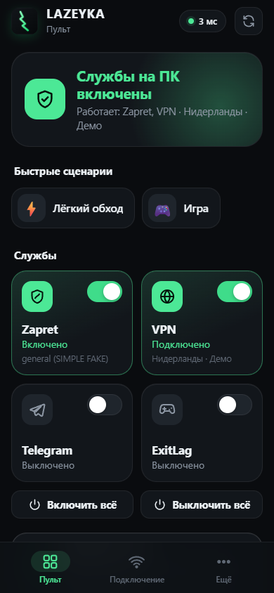
</p>

### YouTube на телевизоре

Приложения телевизора обычно не смотрят на системный прокси, поэтому на
Android TV и Google TV трафик заворачивают в прокси компьютера отдельным
приложением:

1. На компьютере откройте «Локальная сеть», включите раздел и посмотрите адрес
   и порт на вкладке «По порту».
2. На телевизоре поставьте клиент прокси, например v2rayNG или Hiddify (из
   магазина приложений или файлом APK).
3. Добавьте сервер вручную: тип SOCKS5, адрес и порт из LAZEYKA. Если в
   настройках раздела задан пароль, впишите логин и пароль.
4. Включите подключение, запустите проверку YouTube в «По порту» и
   откройте ролик на телевизоре.

У Samsung, LG и многих других телевизоров нет ни поля прокси, ни таких
приложений. Для них подходит «Раздать Wi-Fi»: подключите телевизор к сети
компьютера и проверьте маршрут с включённым INCY. Доступность сайтов на
самом компьютере не подтверждает их доступность с телевизора.

### Телефон

- **Пульт:** отсканируйте QR из карточки «Пульт с телефона». Телефон должен
  быть в той же сети Wi-Fi. Если на телефоне включён VPN, разрешите в нём
  доступ к локальной сети.
- **Браузер через компьютер:** настройки Wi-Fi → ваша сеть → прокси «Вручную»,
  адрес и порт из LAZEYKA. Многие приложения (мессенджеры, игры) прокси Wi-Fi
  не используют; для Telegram есть отдельная кнопка.

### Игровая приставка

- **PlayStation 5:** Настройки → Сеть → Настройки → «Установить соединение с
  интернетом» → ваша сеть → «Настроить вручную» → «Прокси-сервер:
  использовать», адрес и порт из LAZEYKA. Пароль на прокси PlayStation не
  поддерживает. Через прокси идут магазин, браузер и системные запросы; сами
  игры по сети соединяются напрямую.
- **Xbox и Nintendo Switch** настройки прокси не имеют: используйте «Раздать
  Wi-Fi».

Те же сценарии по шагам есть в программе в разделе «Информация» → «Другие устройства».

## Telegram WS-прокси

<p align="center">
  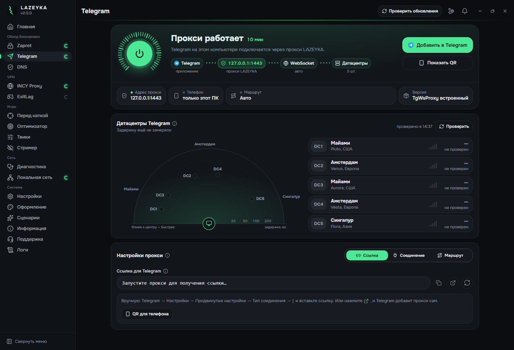
</p>

Локальный MTProto-over-WebSocket релей, отдельный прокси только для
Telegram. Работает в фоне без своих окон и значков. Ускоряет загрузку медиа
и чинит звонки, остальной интернет не трогает. Подключается в один клик
(ссылка уходит прямо в запущенный Telegram), для телефона есть QR-код. На
вкладке видна задержка до дата-центров Telegram.

Работает с Telegram Desktop и форками: AyuGram, 64Gram, Forkgram, Nekogram,
Kotatogram, Unigram.

## Шифрованный DNS

<p align="center">
  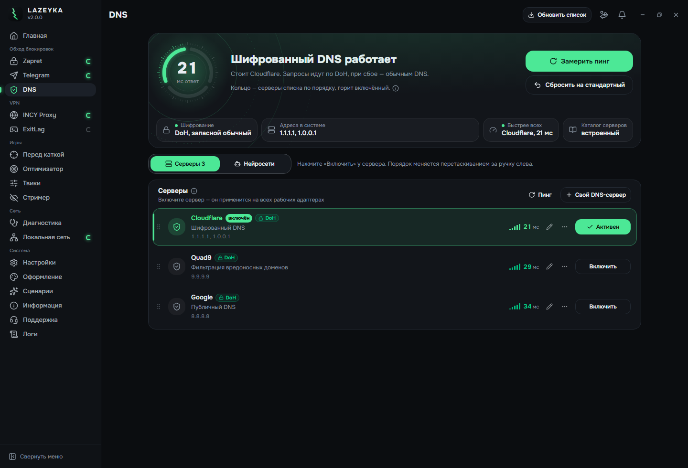
</p>

Каталог серверов с замером задержки: одни открывают нейросети, другие режут
рекламу, третьи просто быстрые. Каталог и адреса серверов обновляются сами,
без новой версии программы; свой сервер можно добавить вручную. Проверка
«Нейросети по DNS» показывает, какой сервер открывает ChatGPT, Claude и Gemini
именно в вашей сети. Иногда одного DNS хватает, чтобы сайт открылся.

## Диагностика

<p align="center">
  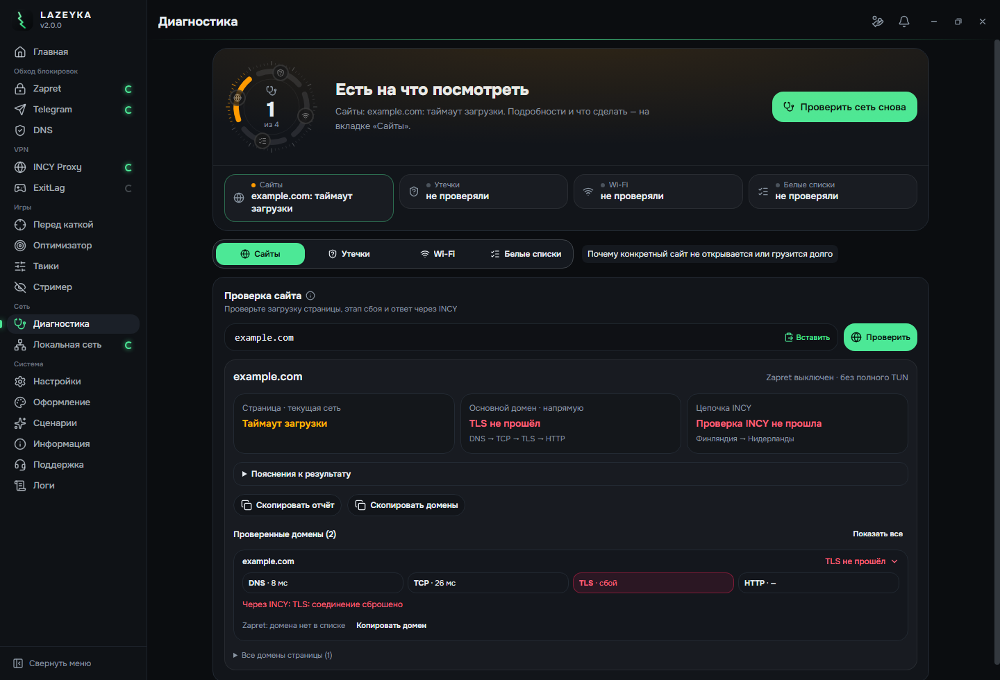
</p>

- **Сайты.** Страница открывается с текущими сетевыми настройками. Для
  основного и проблемных доменов показаны этапы DNS, TCP, TLS и HTTP.
  Отдельная проверка показывает ответ через INCY, включая активную цепочку.
  Повторная проверка того же адреса сравнивает результаты до и после изменений.
- Утечки IP и DNS: что видит сеть снаружи при включённом обходе или VPN.
- Wi-Fi: сигнал и канал вашей сети и соседние сети по каналам — видно, не
  из-за Wi-Fi ли лаги.
- Белые списки: в мобильных сетях бывает режим, когда открываются только
  разрешённые сайты; проверка определяет, ваш ли это случай.

## Оформление и галерея тем

<p align="center">
  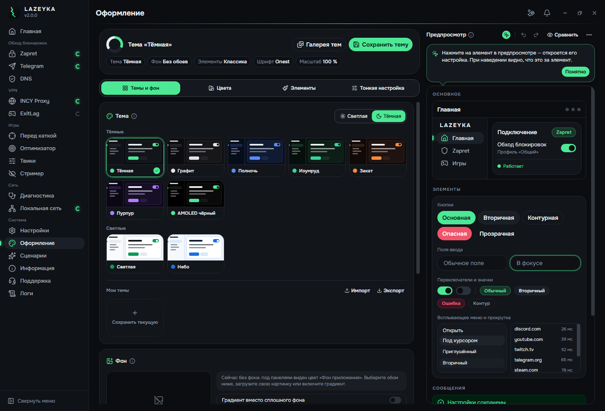
</p>

Темы, цвета, готовые пресеты и свой фон (картинка или анимация) с размытием и
затемнением и живым предпросмотром. Можно настраивать кнопки, переключатели
и карточки по отдельности и проверять читаемость текста. Темы из галереи
применяются одним нажатием. Темы можно лайкать и добавлять в избранное, а в
крупном просмотре отдельно посмотреть интерфейс и фон. Свою тему можно
отправить на проверку автору.

## Настройки

<p align="center">
  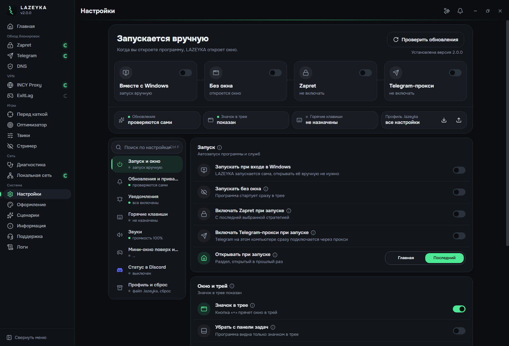
</p>

- Приложение запоминает размер и положение окна, в том числе выбранный монитор.
- Мини-окно поверх игры: маленькое окно с переключателями или только точки
  включённых функций. Это обычное окно поверх остальных, в игру оно не
  встраивается.
- Звуки: общая громкость и отдельно для сценариев и горячих клавиш, сообщений
  автора и сигнала о лагах.
- Статус «Играет в LAZEYKA» в профиле Discord, по переключателю.
- Раздельное туннелирование по сайтам: российские сайты, банки и Госуслуги
  идут напрямую, плюс ваши собственные исключения.
- Резервные копии всех настроек программы в файл `.lazeyka`.
- Ссылки `lazeyka://` (`connect`, `disconnect`, `toggle`, импорт подписки):
  можно сделать ярлык, который включает VPN двойным щелчком.
- Обновления: сама программа, Zapret, TgWsProxy, ядра `sing-box` и `xray`,
  гео-базы. Когда выходит новая версия, открывается окно с описанием
  изменений. Новое ядро проверяется через `sing-box check` или `xray -test`
  до замены рабочего файла, старое остаётся как `.bak`.
- Трей (на Mac — значок в строке меню) и автозапуск вместе с системой; на
  Windows можно убрать значок с панели задач.
- Портативный режим: положите рядом с `.exe` пустой файл `PORTABLE`, и
  данные будут храниться в папке `data/` рядом с программой.

## Сценарии

<p align="center">
  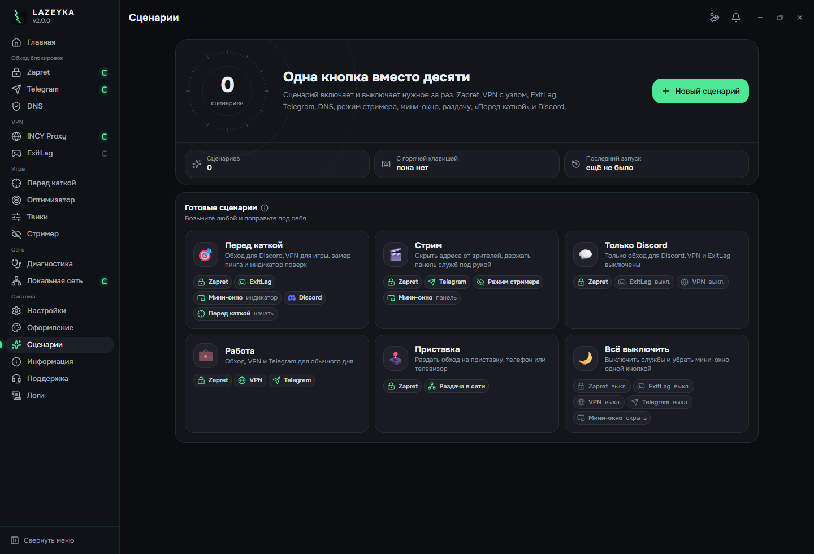
</p>

Сценарий запускает нужный набор служб с нужными параметрами. Для него можно
задать значок, звук и горячую клавишу.

## Информация

<p align="center">
  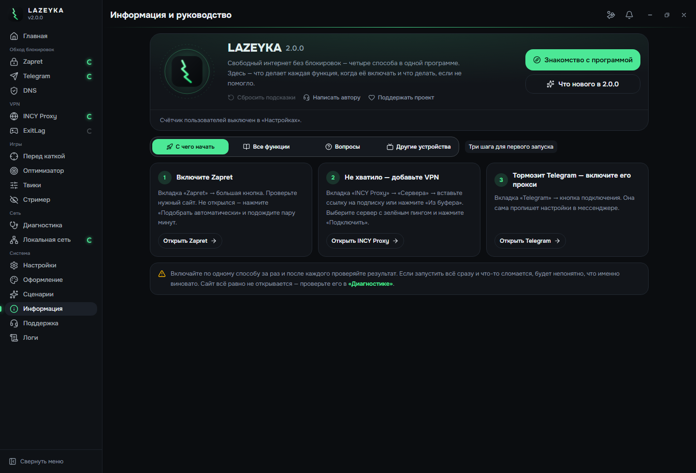
</p>

Справка по режимам подключения, сочетаниям служб и настройке локальной сети.

## Поддержка

<p align="center">
  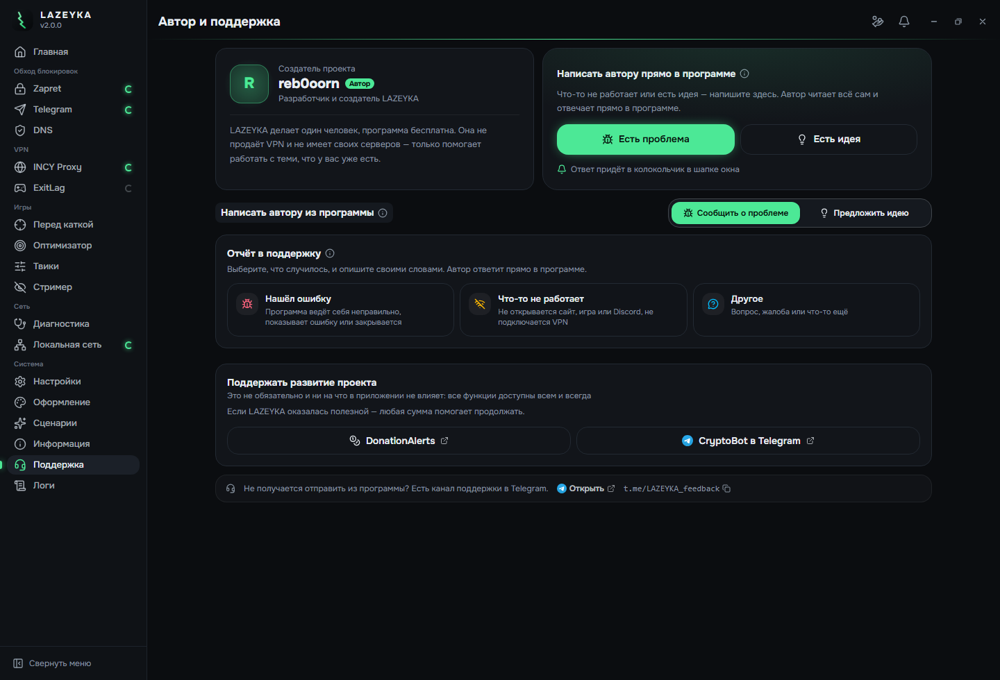
</p>

Откройте «Поддержка» → «Сообщить о проблеме» или «Предложить идею»,
заполните форму и отправьте её из приложения. В отчёте выбираете, что случилось («Нашёл ошибку», «Что-то не
работает», «Другое»), описываете своими словами и по желанию прикладываете
журнал и сведения о системе. Перед отправкой виден весь текст; адреса, ключи,
ссылки подписок и имя пользователя в нём скрыты. Отчёты читает автор сам, а
ответ приходит в колокольчик в шапке окна. Там же появляются объявления и
предупреждения автора. Для общих вопросов есть [канал LAZEYKA в Telegram](https://t.me/LAZEYKA_feedback).

## Логи

<p align="center">
  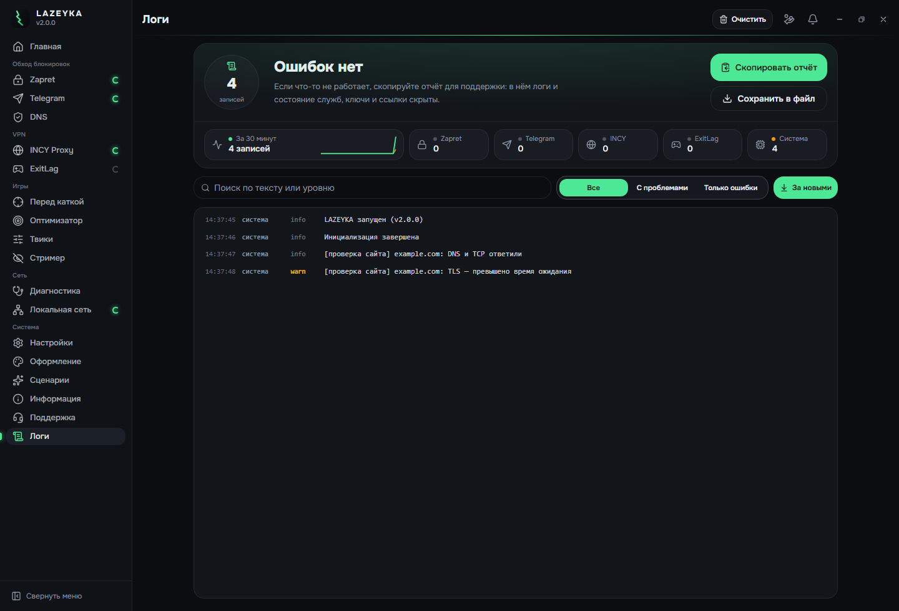
</p>

Здесь можно найти сбой по времени и модулю и скопировать нужный фрагмент
для отчёта в поддержку.

## macOS

LAZEYKA для Mac — та же программа с тем же интерфейсом: Zapret, INCY (включая
TUN), Telegram, ExitLag, оптимизатор, шифрованный DNS и локальная сеть (пульт
и прокси для устройств).

**Установка.** Откройте `.dmg` и перетащите LAZEYKA в «Программы». Сборка
подписана ad-hoc, без платного сертификата Apple, поэтому при первом запуске
macOS скажет, что не может проверить приложение:

1. В первом окне нажмите «Готово».
2. «Системные настройки» → «Конфиденциальность и безопасность» → внизу
   «Всё равно открыть», затем ещё раз «Всё равно открыть».

Правый клик → «Открыть» на новых macOS больше не помогает. Можно и одной
командой в Терминале: `xattr -dr com.apple.quarantine /Applications/LAZEYKA.app`.

**Пароль — один раз.** Режим TUN в INCY и Zapret на Mac работают через
системные службы с правами администратора. При первом включении программа
предложит «Установить службу», macOS спросит пароль, и дальше всё включается
без пароля. Службы можно обновить или удалить в карточках «Служба macOS» и
«Служба Zapret». Пароль спрашивается ещё при обновлении Zapret и службы —
так ни одна посторонняя программа не может подменить то, что работает с
правами администратора.

**Шифрованный DNS** на Mac ставится профилем: кнопка «Включить» создаёт и
открывает профиль DoH выбранного провайдера. Его нужно подтвердить:
«Системные настройки» → «Основные» → «Управление устройством» → профиль
LAZEYKA → «Установить», затем «Сеть» → «VPN и фильтры» → «Включено».

**Отличия от Windows.** Нет Game Filter и конструктора стратегий Zapret,
нет «Раздать Wi-Fi» (устройства подключаются через прокси),
в пресетах ExitLag нет CS2 (под Mac его не выпускают). Обновление программы
не ставится само: LAZEYKA сообщает о новой версии и открывает загрузку `.dmg`,
её нужно перетащить в «Программы» поверх старой.

## Ubuntu

**Первая Linux-сборка LAZEYKA** рассчитана на Ubuntu 24.04 с процессором x64.
Скачайте пакет из таблицы выше, откройте терминал в папке с файлом и выполните
команду. Затем найдите LAZEYKA в меню приложений.

```bash
sudo apt install ./LAZEYKA_amd64.deb
```

- **Zapret** — 22 профиля Flowseal, проверка одной стратегии или всего списка,
  автоподбор, списки доменов и исключений, Game Filter и конструктор на основе профилей.
- **INCY и ExitLag** — режим TUN и маршрутизация по списку приложений в обе стороны.
  Системный прокси доступен в GNOME.
- **DNS, Telegram и пульт** — обычный и шифрованный DNS через systemd-resolved,
  Telegram-прокси и управление с телефона в одной локальной сети.

Ubuntu запрашивает права администратора при включении системных служб.
Обновление устанавливается из нового пакета `.deb`. Kill Switch на Linux пока
недоступен. [Сборка пакета из исходников](./RELEASING.md#сборка-ubuntu).

## Приватность

Настройки и логи хранятся на вашем компьютере. На Windows это
`%APPDATA%\lazeyka` или `data/` в портативном режиме, на Mac —
`~/Library/Application Support/lazeyka`, на Ubuntu — `~/.config/lazeyka`
при стандартных настройках. Программа выходит в сеть за
обновлениями (GitHub), за гео-базами, к серверу вашей подписки и раз в 30
минут к серверу LAZEYKA за объявлениями и ответами автора — без логов и
настроек. Отчёт, идею или тему отправляете только вы сами, кнопкой. Анонимный
счётчик «сколько людей онлайн» выключается в настройках. Телеметрии нет.

При первом запуске генерируются случайный секрет для Telegram-прокси и
логин с паролем для локального прокси, так что на двух установках они
разные. В резервную копию они не попадают.

## Требования

- Windows 10 или 11 (x64), права администратора: Zapret работает на уровне
  сетевого драйвера, а режим TUN создаёт виртуальный сетевой адаптер.
- macOS 14 Sonoma или новее, Apple Silicon или Intel. Пароль администратора
  нужен один раз — для установки служб TUN и Zapret.
- Ubuntu 24.04 (x64). Для управления Zapret, TUN и системным DNS могут понадобиться права администратора.

## Разработка

```bash
pnpm install
pnpm dev
```

В режиме разработки данные лежат в отдельной папке `%APPDATA%\lazeyka-dev`,
рабочий конфиг не затрагивается.

```bash
pnpm typecheck    # tsc для main и renderer
pnpm lint
pnpm build:win    # из консоли с правами администратора
```

Установщик для Windows собирается только на Windows: он делается через NSIS,
а в `node_modules` лежит Windows-сборка Electron. Образы `.dmg` для Mac
собирает GitHub Actions (`.github/workflows/build-mac.yml`) — сам, как только
опубликован релиз; руками на Mac ничего собирать не нужно.
Пакет Linux тоже собирает GitHub Actions (`.github/workflows/build-linux.yml`)
на Ubuntu 24.04 x64 и добавляет его к релизу.

Как выпускать релизы и как устроено автообновление: [RELEASING.md](./RELEASING.md).
Устройство программы по модулям: [docs/ARCHITECTURE.md](./docs/ARCHITECTURE.md).

### Стек

- Electron 37 и TypeScript, сборка через `electron-vite`
- React 19, Vite, Tailwind CSS 4, shadcn/ui, Radix, Lucide
- Zustand для состояния, типизированный IPC между main и renderer
- electron-builder: NSIS на Windows (установщик для всех пользователей с
  правами администратора), DMG на macOS (ad-hoc подпись, сборка в CI)
- PyInstaller для сборки TgWsProxy

## Лицензия и сторонние проекты

LAZEYKA распространяется под [GPL-3.0](./LICENSE).

Сетевые движки написаны не здесь, программа ими управляет. Список проектов,
их лицензии и ссылки на исходники: [THIRD-PARTY-NOTICES.md](./THIRD-PARTY-NOTICES.md).

## Поддержать проект

LAZEYKA бесплатна, и все функции доступны всем. Пожертвования ни на что в
программе не влияют.

Поддержать разработку можно по прямой ссылке.

- [DonationAlerts](https://www.donationalerts.com/r/reb0oorn)
- [CryptoBot в Telegram](https://t.me/send?start=IVCka2D1cl42)

В приложении откройте «Поддержка» → «Поддержать», чтобы посмотреть цель
и прогресс сбора. После перевода нажмите «Я отправил пожертвование» и укажите сумму и ник —
автор сверит перевод и добавит вас на стену благодарностей. Цвет ника на стене
зависит от суммы.

## Автор

Разработка и поддержка: reb0oorn.
